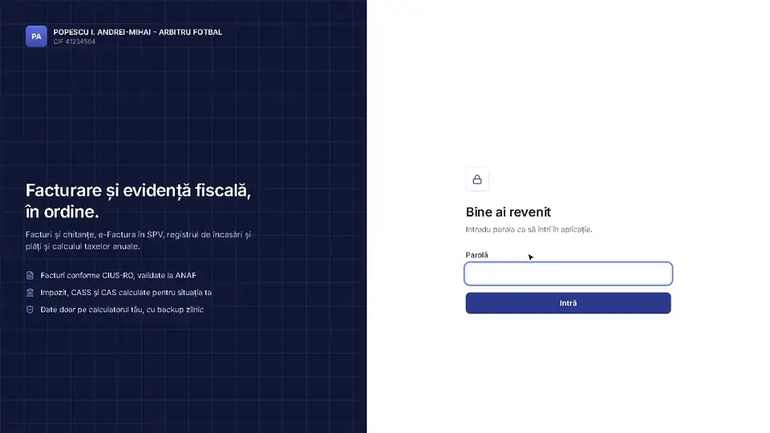
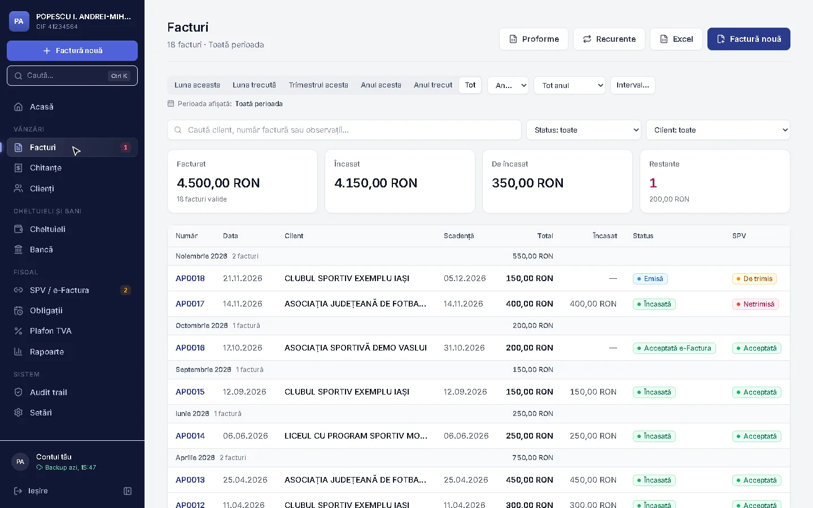
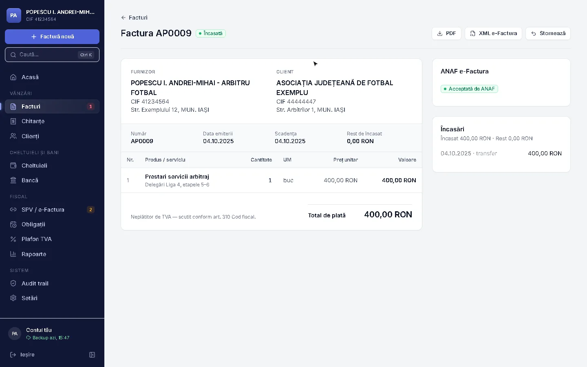
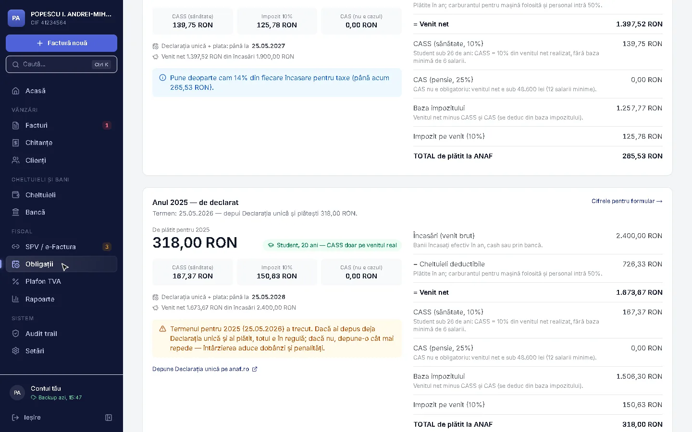
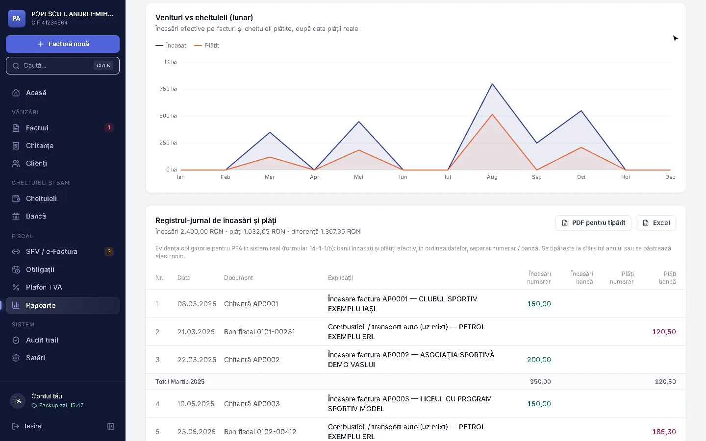
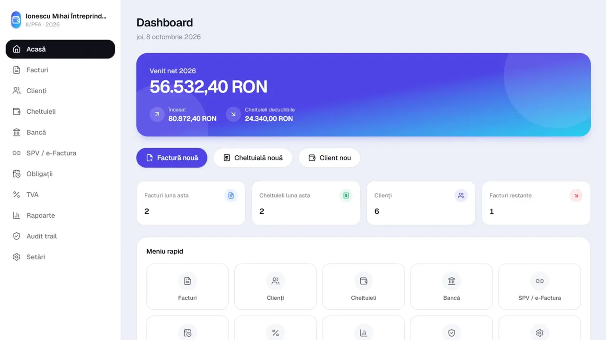
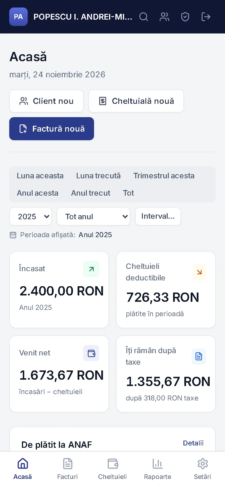

# 🧾 Contabilitate PFA · e-Factura

  
  
  
  
  
  
  

> This is a showcase repository. The source code is kept in a private repository. All screenshots and the video use a demo database with **fictional data**.

An invoicing and tax app for a Romanian **self-employed individual (PFI/PFA)** on the real-income system, not registered for VAT. I built it for my own activity as a football referee, and it **replaced a commercial invoicing app (Oblio)** in daily use: all existing invoices, receipts, expenses and clients were migrated automatically. It runs **only on my own computer** (local HTTPS, password, daily backup to OneDrive) and sends invoices straight to the tax authority through **RO e-Factura (ANAF)**.

  

<a href="./assets/demo.mp4">▶ Full walkthrough video (1:49)</a>

## Features

**Invoicing**
- Gap-free numbering per series (`AP0019`), multiple lines with details (match, competition), **suggestions from previous invoices** (service, price, unit).
- **Editable until it reaches the tax portal**; after that only a **credit note (storno)** linked to the original invoice, with `BillingReference` in the XML. Cancelling keeps the number and always asks for confirmation.
- Payments, and an **automatic receipt** for cash payments (its own series), included in the invoice PDF. Receipts list, pro-forma and recurring invoices.

**RO e-Factura (ANAF)**
- UBL 2.1 / **CIUS-RO XML written from scratch**, **checked against ANAF's public validator before every upload**, so a broken invoice never gets rejected in the tax portal.
- OAuth2 with a qualified digital certificate (client authenticated with Basic auth, as the official procedure requires), automatic token refresh, or a pasted token checked live against the API.
- Upload, status polling, signed response download, sync of invoices received from suppliers.

**Taxes, computed for the user's real situation**
- Per-year tax profile: age is read from the national ID number, and a "student" flag applies the rule that a **student under 26 pays health insurance (CASS) on actual income**, not on the 6-minimum-wage floor.
- Step-by-step calculation: income − deductible expenses (mixed-use fuel at 50%) = net income → CASS → pension (CAS, only above 12 minimum wages) → 10% income tax after deducting contributions.
- Figures for the yearly tax return with a copy button, deadline countdown, alerts (pension threshold, VAT threshold, missed deadline, tax loss) and "set aside X% of every payment".
- The legally required **cash & bank ledger** (form 14-1-1/b) with monthly and yearly totals, as a **print-ready PDF** and an **Excel** file.

**Staying organised**
- **Period filter on every list** (this/last month, quarter or year, any year, month or quarter, custom range), lists grouped by month with subtotals.
- Search and status / client / category / payment-method filters, and an **Excel export of exactly what is on screen**.
- **Ctrl+K command palette**: jump to any page, invoice number or client.
- Sidebar **counters**: invoices still to send to ANAF, overdue invoices, days until the tax return, plus backup status. Collapsible to icons.

**Data safety**
- Listens only on `127.0.0.1`, **local HTTPS** (mkcert), scrypt password, HMAC-signed session, lockout after failed attempts, OAuth secrets never reach the browser.
- **Consistent SQLite backups** (`VACUUM INTO`) at start-up and daily: local copies plus OneDrive, with rotation. Error log on disk, automatic server restart, a Windows launcher that only rebuilds when the code changes.

<table>
<tr>
<td width="50%">
Invoices: period filter, month groups, ANAF status
</td>
<td width="50%">
Invoice as a document, with ANAF and payments panels
</td>
</tr>
<tr>
<td width="50%">
Taxes calculated for a student under 26
</td>
<td width="50%">
Cash &amp; bank ledger, PDF and Excel
</td>
</tr>
<tr>
<td width="50%">
Dashboard: income, deductible expenses, what is left after taxes
</td>
<td width="50%" align="center">
Every page fits a 390 px phone screen
</td>
</tr>
</table>

## Under the hood

- **Next.js App Router**: Server Components for reads, one Server Actions module per domain, route handlers for PDF / XML / CSV, an auth proxy, and `deploymentId` so a browser tab left on an old build reloads instead of failing.
- **Money is stored as integers** (bani, 1/100 leu). **Invoice and receipt numbers are allocated in atomic transactions.**
- **One source of truth** for shared rules: list filters are reused by the pages and by the Excel exports; "still to be paid" (not paid, not reversed) is defined once.
- **Pure tax module** (no database access) used on both server and client, with yearly constants (CASS cap of 60 vs 72 minimum wages in 2025/2026).
- The ledger is computed once and rendered as a page table, a landscape PDF with a repeated header, and a CSV.
- **Credit notes are a relation** between invoices: the original drops out of "to be paid", and the credit note's XML references it.
- **Responsive design system**: data tables on desktop, compact lists on phones, segmented controls, status badges, confirmation for irreversible actions.
- **Tested end to end** with Puppeteer on a demo database: 51 steps, including real validation of the generated XML against ANAF's public validator, plus a phone-width check of all 17 pages. The demo video and these screenshots are generated by script.

## Tech stack

Next.js 16 · React 19 · TypeScript (strict) · Prisma · SQLite · Zod · Tailwind CSS v4 · @react-pdf/renderer · Inter · Puppeteer · ffmpeg · ANAF RO e-Factura API (OAuth2, UBL 2.1 / CIUS-RO)

## Source code

The code is private. If you would like to see it, contact me through my [GitHub profile](https://github.com/radasanuflorin).
